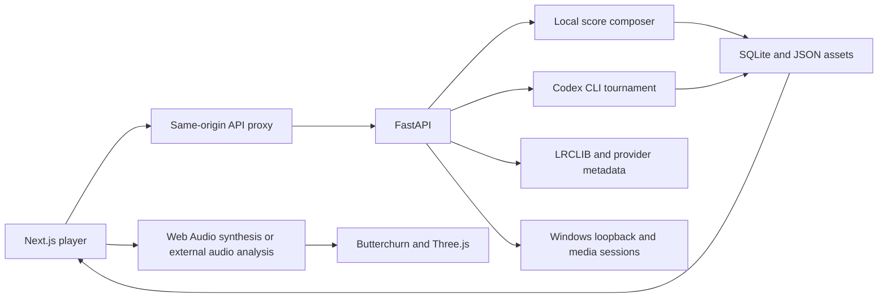

# Architecture

[Documentation index](README.md)

## Services and data flow

The Next.js player talks to FastAPI through a same-origin `/api/*` proxy. The proxy forwards query parameters, keeps the optional studio token server-side, and streams loopback audio without the normal request timeout. FastAPI stores metadata in SQLite and assets in the local filesystem by default.

## Code map

| Path | Responsibility |
| --- | --- |
| `apps/web/app/page.tsx` | Player, transport, playlist, settings, and Codex panels |
| `apps/web/components/` | Effects menu, visual engines, external playback, and lyrics |
| `apps/web/lib/` | Audio scheduling/analysis, provider adapters, render sizing, and GPU frame gates |
| `apps/api/clanker_api/` | API routes, persistence, jobs, tournaments, lyrics, and Windows capture |
| `packages/music-core/clanker_music/` | Typed score plans, composition, validation, and performance compilation |
| `packages/audio-analysis/` | Offline audio analysis |
| `packages/contracts/` | Shared schemas and generated TypeScript contracts |
| `assets/licenses/` | Provenance for procedural sound implementations |

## Score and audio pipeline

A local composer or Codex plan provides motifs, harmony, rhythm, instrument roles, and sections. The performance compiler produces timed note events for 24 procedural voices. The browser schedules these through Web Audio with envelopes, panning, reverb, delay, and compression. Instrument entrances and rests vary across the arrangement. Duration is quantized to complete sections, so short target durations can run longer.

A shared visual-audio interface supplies frequency and energy data to the visualizers. External direct audio can use a media element; tab sharing uses a captured stream. Windows loopback sends downsampled PCM from a bounded queue to a silent analysis graph, avoiding replay of the captured system output. Capture workers stop when the client disconnects.

## Visual pipeline

Butterchurn runs MilkDrop preset equations and feedback warping, using base, Extra, and Extra2 preset packs. The DOM canvas dimensions and renderer viewport agree at every quality setting. A silent AudioContext lets the real engine initialize before a track exists; playback switches it to the music context. Reduced motion freezes its rendered frame.

Three.js supplies the original shader and mesh/particle themes, with bloom and output postprocessing where applicable. Scene changes dispose GPU resources. The Randomizer selects across engines without consecutive scene repeats. Nonblocking GPU fences limit pending frames at high resolutions.

## Persistence and curation

| Local path | Contents |
| --- | --- |
| `.data/clanker.db` | SQLite metadata |
| `.data/assets/performances/` | Playable score JSON |
| `.data/assets/tournaments/` | Composer drafts, critiques, revisions, and verdicts |
| `artifacts/browser/` | Local test screenshots |

Favorites and approved tournament winners form the kept playlist. Symbolic duplicate detection groups repeated plans and ranks versions. The archive API returns the latest 100 entries; older JSON files remain on disk. A fresh clone intentionally has no local library or account credentials.

## Current boundaries

The native local stack is the verified deployment. Multi-user authentication, automatic publishing, MP4 export, catalog-wide originality checks, and automatic recovery of interrupted tournaments are not implemented. Browser playback needs an open audio-enabled browser; production continues only while the API is running.

Earlier `/api/compositions/*` endpoints still provide the blueprint/MIDI/WAV-stem prototype. `scripts/render_fixture.py` exercises that offline fixture. Its small instrument set is separate from the 24-voice live performance workflow.

The [original specification](../clanker_radio_docs/README.md) describes the larger production roadmap. Dependency licensing and research references are maintained in [third-party notices](../THIRD_PARTY_NOTICES.md).
